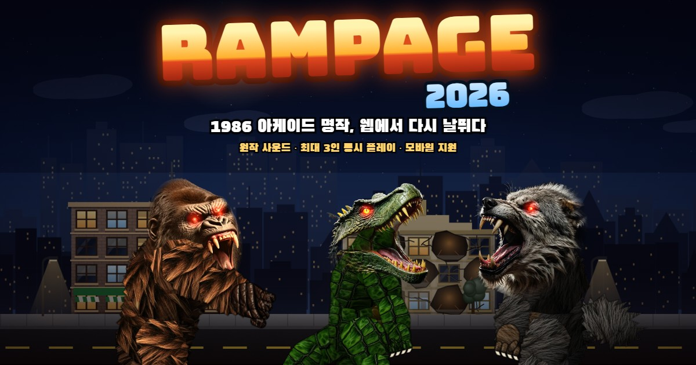

# RAMPAGE 2026

1986 Bally Midway **Rampage**의 웹 리메이크. 게임 규칙과 텍스트 데이터, 사운드는 원작 ROM에서 가져왔고, 그래픽은 모두 새로 만들었습니다.

## 실행

ES 모듈과 `fetch`(사운드 로딩)를 쓰기 때문에 `file://`가 아니라 웹 서버로 열어야 합니다. 빌드 단계는 없습니다.

```bash
npm start            # 의존성 없는 Node 정적 서버 (server.js), 기본 포트 8026
# 또는
python -m http.server 8026
```

브라우저에서 http://localhost:8026 을 엽니다.

## 배포 (Render.com)

**Web Service**로 배포하는 경우:

| 항목 | 값 |
|---|---|
| Runtime | Node |
| Build Command | `npm install` |
| Start Command | `npm start` |

`server.js`는 Render가 넣어 주는 `PORT` 환경 변수를 그대로 씁니다. 의존성이 없어서 `npm install`은 사실상 아무것도 하지 않습니다.

**Static Site**로 배포하는 경우(무료, 더 빠름): Build Command는 비우거나 `echo ok`, Publish Directory는 `.`로 둡니다.

### 링크 미리보기(썸네일)



- 링크를 공유하면 `assets/og/thumbnail.jpg`(1200×630)가 미리보기 이미지로 나옵니다(Open Graph, Twitter Card). 카카오톡, 페이스북, X, 슬랙, 디스코드 등에서 쓰입니다.
- 대부분의 미리보기 크롤러는 이미지 주소가 절대 URL이어야 합니다. **Web Service**로 배포하면 `server.js`가 접속 도메인을 보고 `og:image`, `og:url`을 자동으로 `https://<도메인>/...` 형태로 바꿔 줍니다. 커스텀 도메인을 고정하려면 환경 변수 `PUBLIC_URL`(예: `https://rampage.example.com`)을 설정하세요.
- **Static Site**로 배포하면 서버가 주소를 바꿔 주지 않습니다. `index.html`의 `og:image`, `og:url`, `twitter:image` 값을 배포 주소가 들어간 절대 URL로 직접 바꿔 주세요.
- 썸네일은 게임 렌더러로 다시 만들 수 있습니다: 서버를 띄운 뒤 `python tools/make_thumbnail.py`.
- 카카오톡은 미리보기를 캐시합니다. 이미지를 바꾼 뒤에는 [카카오 공유 디버거](https://developers.kakao.com/tool/debugger/sharing)에서 캐시를 초기화하세요.

## 저장 · 이어하기

- 매 스테이지(날)가 시작될 때 진행 상황(날짜, 참가 플레이어, 점수)이 브라우저 localStorage에 자동 저장됩니다.
- 타이틀 메뉴
  - **이어하기**: 마지막으로 저장된 스테이지부터, 저장된 점수로 계속합니다.
  - **스테이지 선택**: 지금까지 도달한 스테이지 중 원하는 날을 골라 0점부터 시작합니다(←/→, 터치 시 ◀ ▶).
- 게임오버가 되어도 저장은 남아 있어 그 스테이지부터 다시 할 수 있습니다.

## 모바일

- 가로 화면 전용입니다. 세로로 들면 화면을 돌리라는 안내가 나옵니다.
- 왼쪽 아날로그 패드(8방향), 오른쪽 PUNCH/JUMP 버튼, 오른쪽 위 START·일시정지·전체화면 버튼이 있습니다.
- 메뉴, 신문 화면, 사운드 테스트는 화면을 직접 터치해 조작합니다.
- 홈 화면에 추가하면 전체화면 앱처럼 실행됩니다(web manifest).

## 조작

| 플레이어 | 이동 | 펀치 | 점프 | 참가/시작 |
|---|---|---|---|---|
| 1P (기본 GEORGE, 변경 가능) | 방향키 | Z / Space | X | Enter / 1 |
| 2P | WASD | F | G | 2 |
| 3P | IJKL | O | P | 3 |

- 게임패드 1~3번은 각각 플레이어 1~3에 연결됩니다(스틱/D-pad, A 점프, X/B 펀치, Start).
- **캐릭터 선택**: 1인용이어도 George, Lizzie, Ralph 중 원하는 괴물을 고를 수 있습니다.
  - 타이틀 메뉴 맨 위 「캐릭터 (1P) ◀ ▶」에서 ←→로 바꾸고, Enter/Z를 누르면 그 괴물로 새 게임을 시작합니다.
  - 모바일에서는 아래쪽 괴물 그림을 탭하면 됩니다.
  - 2P와 3P는 남은 두 괴물을 순서대로 맡습니다(조작 키는 위 표대로 플레이어 번호를 따름).
  - 선택은 브라우저에 기억되고, 이어하기를 하면 저장 당시의 괴물로 계속합니다.
- 타이틀: ↑↓로 메뉴 선택, Enter/Z로 결정. 2P·3P는 타이틀에서 2·3 키로 참가하고, 게임 중에도 참가할 수 있습니다(JOIN IN NOW).
- `T` 사운드 테스트, `M` 음소거, `V` 실사/클래식 그래픽 전환, `ESC` 일시정지(Q: 타이틀로).
- 먹기: 창문 속 사람이나 음식을 펀치하면 손에 쥐고 입으로 가져가 CHOMP! CHOMP! GULP! 한 뒤 체력이 회복됩니다.

## 게임 규칙 (원작 기준)

- 빌딩 옆면에 붙어(↑) 오르내리고, 펀치로 벽을 부숩니다. 같은 칸을 한 번 치면 금이 가고, 두 번 치면 구멍이 납니다.
- 손상이 일정량을 넘으면 빌딩이 흔들리다 먼지를 일으키며 무너집니다. 위에 있던 괴물은 떨어집니다("JUMP WHEN YOU SEE DUST CLOUDS").
- 창문에 나타난 사람·음식을 펀치로 잡아먹으면 체력이 회복됩니다. 선인장·독·토스터·전구·TNT는 체력을 깎습니다. 돈자루·화분·TV는 보너스 점수입니다.
- 창문 속 군인, 지상 군인, 헬기, 탱크가 공격해 옵니다. 헬기는 펀치로, 차량·탱크는 아래 펀치나 위에서 밟아서 부숩니다. 지상 군인은 잡아먹을 수 있습니다.
- 체력이 0이 되면 괴물은 사람으로 돌아가 도망칩니다. 10초 안에 시작 키를 누르면 이어서 할 수 있습니다(점수 유지).
- 빌딩을 모두 무너뜨리면 다음 날, 다음 도시로 넘어갑니다. 도시는 원작 ROM의 85개 도시 순서를 따릅니다.

## 원작에서 가져온 것

| 항목 | 출처 |
|---|---|
| 도시 85개(PEORIA → … → PLANO ILL.) | Z80 ROM `0x9610` |
| 뉴스 헤드라인·힌트 24개 | Z80 ROM `0x69AC` |
| 음식/위험/보너스 아이템 종류 | Z80 ROM `0xB2BB`, 스프라이트 ROM |
| 사운드 87종 | Sounds Good 보드(68000+DAC)를 MAME에서 코드별로 녹음 |
| 캐릭터·적·소품 구성, 점수 단위(50/100/350/500/1000) | 스프라이트 ROM(fg-0..3) 디코딩 |

`js/data.js`는 `tools/build_data.py`가 `tools/rom_text.json`으로부터 생성합니다. 분석 과정은 아래 [역분석 과정](#역분석-과정-reverse-engineering)과 `tools/re/ANALYSIS.md`에 정리했습니다.

## 역분석 과정 (Reverse Engineering)

원작 소스 코드는 공개되어 있지 않습니다. 그래서 아케이드 기판의 ROM 덤프(프로그램 ROM 2개, 사운드 ROM 4개, 그래픽 ROM 6개)를 직접 분석해 게임 데이터와 동작을 알아냈습니다. 자세한 기록은 [`tools/re/ANALYSIS.md`](tools/re/ANALYSIS.md)에 있습니다.

### REA를 사용했나요?

**네, 사용했습니다.** 다만 이 게임에서는 쓰임새가 제한적이었습니다.

- [REA (Reverse Engineer Anything)](https://github.com/morluto/rea) `rea-agents` 6.7.0을 설치하고, Ghidra 12.1.4(JDK 21)를 분석 엔진(provider)으로 연결했습니다. `rea doctor`로 ghidra provider가 healthy인 것도 확인했습니다.
- 그런데 REA가 헤더 없는 raw 바이너리에 대해 지원하는 CPU는 `6502/x86/x86_64/arm/arm64/m68k`이고, **Rampage 메인 CPU인 Z80은 목록에 없습니다.** 그래서 `rea analyze --architecture`로 직접 분석할 수 없었습니다.
- 대신 REA의 **Rizin provider**(`rea execute-rizin-command`)로 Z80 코드를 분석했습니다. 래퍼 스크립트는 [`tools/re/rea_rz.sh`](tools/re/rea_rz.sh)입니다. REA가 Rizin에 `e asm.arch=z80` 설정과 분석 명령을 넘기고, 결과를 증거(evidence) JSON으로 돌려줍니다.
  ```bash
  ./rea_rz.sh z80_main.bin "aaa; afl"        # 자동 분석 → 함수 543개
  ./rea_rz.sh z80_main.bin "aaa; pdr @@F"    # 함수별 디스어셈블 (21,584줄)
  ./rea_rz.sh z80_main.bin "pD 0xe000 @ 0"   # 선형 디스어셈블 (32,600줄)
  ```
- 사운드 보드 CPU(68000)는 REA가 지원하는 `m68k`입니다. 하지만 사운드는 코드를 해석하기보다 에뮬레이터에서 **실제 출력을 녹음하는 쪽**이 정확해서, 68000 코드는 이미지 조립과 리셋 벡터 확인까지만 했습니다.
- REA는 디스어셈블과 함수 찾기에 썼습니다. 그 결과를 해석하는 일과 나머지 분석(동적 분석, 그래픽 디코딩)은 아래 도구들로 직접 했습니다.

### 단계별 진행

1. **하드웨어 파악**
   - MAME의 `bally/mcr3.cpp`, `mcr_v.cpp` 드라이버 소스를 하드웨어 문서로 참고했습니다. 이 기판은 MCR 모노보드와 Sounds Good 사운드 보드 조합입니다.
   - 메모리 맵(RAM `E000`, 스프라이트 RAM `E800`, 팔레트 `EC00`, 비디오 RAM `F000`)과 I/O 포트(포트 6 = 사운드 명령)를 확인했습니다.
   - 프로그램 ROM 2개를 합쳐 64KB Z80 이미지를 만들었습니다. 사운드 ROM 4개는 짝수/홀수 바이트를 엮어 68000 이미지로 만들었고, 리셋 벡터(SP=0x070800, PC=0x26E4)가 정상인지로 조립이 맞는지 검증했습니다.
   - MAME 0.289 `-verifyroms`로 ROM 세트가 Rev 3(8/27/86)임을 확인했습니다.

2. **정적 분석: REA + Rizin 디스어셈블**
   - 문자열 스캔으로 데이터 테이블을 찾았습니다: 도시 85개(`0x9610`), 뉴스 헤드라인과 힌트 24개(`0x69AC`), 아이템 설명(`0xB2BB`), 크레딧(`0xAF30`).
   - 사운드 시스템을 역추적했습니다:
     - `out (0x06),a` 명령을 검색해 송신 루틴(`0x056A`)을 찾았습니다.
     - 그 루틴이 쓰는 RAM 큐 `E61C/E61E`를 따라가 `PlaySound(C)` 함수(`0x6501`)를 찾았습니다.
     - `RST 20h`가 이 함수를 부르는 단축 호출이라는 것을 알아냈습니다.
     - 모든 호출부의 `ld c,XX` 값을 모아 사운드 코드 47종 이상을 뽑았습니다.
   - 사운드 전송 프로토콜을 해독했습니다. 8비트 코드를 니블(4비트) 두 개로 나누고 스트로브 비트와 함께 포트 6에 씁니다.

3. **동적 분석: MAME + Lua 스크립트** ([`tools/re/mame_lua/`](tools/re/mame_lua))
   - **사운드 녹음** (`rec_ingame.lua`)
     - 코인을 넣고 게임을 시작한 뒤, `PlaySound` 진입점을 실행 중에 `RET`으로 패치해 게임이 스스로 내는 소리를 막습니다.
     - 큐에 `[정지(0x00), 코드]`를 직접 넣고 `-wavwrite`로 녹음합니다. MAME 8개를 병렬로 돌려 코드 0x00~0x7F 전부를 녹음했습니다.
     - 코드별로 잘라 DC 성분을 제거하고 정규화했습니다. 루프 사운드는 자기상관으로 주기를 찾아 끊김 없이 반복되게 잘랐습니다. 최종적으로 소리가 나는 코드 87개를 얻었습니다.
   - **이벤트 매핑** (`bot_play.lua`)
     - 무작위로 조작하는 봇이 실제 게임을 플레이하게 합니다.
     - I/O 쓰기 탭으로 포트 6을 감시해 사운드 코드를 시간과 함께 기록하고, 코드가 처음 나올 때마다 화면을 스냅샷으로 남겼습니다.
     - 화면과 코드를 대조해 의미를 추정했습니다. 예: `10/01` 헬기 루프 시작/정지, `4E→4C` 빌딩 붕괴, `5C` 괴물→인간 변신, `6A` 코인.
   - **그래픽 덤프** (`dump_gfx.lua`)
     - 팔레트 RAM 쓰기를 탭으로 잡아 9비트 RGB 팔레트를 복원했습니다.
     - 플레이 중 스프라이트 RAM과 비디오 RAM을 주기적으로 덤프했습니다.

4. **그래픽 디코딩** ([`tools/re/gfxdecode.py`](tools/re/gfxdecode.py), [`render_dump.py`](tools/re/render_dump.py))
   - MAME의 `mcr_bg_layout`/`mcr_sprite_layout` 정의대로 배경 타일(8×8 4bpp, 1024개)과 스프라이트(32×32 4bpp, 512개)를 디코딩했습니다.
   - 덤프로 다시 그린 화면이 MAME 스냅샷과 일치하는 것을 확인해 디코더를 검증했습니다.
   - 덕분에 원작에 어떤 적, 아이템, 간판, 점수 표시가 있는지 목록을 정리할 수 있었습니다. 다만 원작 그래픽 자체는 게임에 쓰지 않았고 모두 새로 만들었습니다.

5. **리메이크에 반영한 것**
   - ROM 텍스트 데이터는 `tools/build_data.py`로 `js/data.js`를 자동 생성합니다.
   - 녹음한 원본 사운드는 `assets/sfx/`에 넣었습니다.
   - 게임 규칙은 원작 구성을 따랐습니다: 빌딩 오르기, 3방향 펀치, 창문 속 음식·사람·위험물, 군인·헬기·탱크·차량, 붕괴, 체력이 다하면 인간으로 변신, 도시 순서, 신문 화면.

### 분석 결과의 한계
- 이동 속도, 피해량, 적 출현 빈도 같은 **수치는 코드에서 뽑아낸 값이 아닙니다.** 원작 플레이 영상(봇 플레이)을 보고 맞춘 값입니다.
- 일부 사운드 코드의 의미는 추정입니다. 게임 안의 사운드 테스트(`T`)로 원본 87종을 모두 들어볼 수 있고, `js/audio.js`의 `SFX` 표에서 바꿀 수 있습니다.
- `tools/re/`의 스크립트에는 작업 PC 경로(`I:/ai_root/...`)가 들어 있으니 쓰는 환경에 맞게 고쳐야 합니다. ROM 파일과 ROM에서 뽑은 바이너리는 저작권 때문에 저장소에 넣지 않았습니다.

## 그래픽

외부 이미지 사이트에서 가져온 것은 없습니다. 모든 그래픽은 직접 생성하거나 코드로 그렸습니다.

### 실사 괴물 (기본값, `V` 키로 클래식 벡터 스타일과 전환)
- **머리**: RealVisXL V4.0(SDXL)을 로컬 GPU(RTX 3070)에서 돌려 만든 실사 사진입니다. 괴물마다 으르렁(snarl)과 포효(roar) 2종이 있습니다. rembg로 배경을 지우고, 목 부분은 몸통에 섞이도록 부드럽게 페이드 처리했습니다. 입을 벌리는 정도에 따라 두 사진을 바꿔 끼워 포효와 씹기 애니메이션을 만들고, 눈은 원작처럼 빨갛게 발광합니다.
- **몸**: 실사 재질 텍스처(고릴라 털과 가죽, 비늘과 배 비늘, 늑대 털)를 이음새 없이 타일링했습니다. 근육 모양 파츠에 뼈 방향으로 결을 맞춰 입히고, 조명 방향 음영을 multiply로 얹습니다.
- 생성과 가공 스크립트는 `tools/gen_assets.py`, `tools/cut_heads.py`, `tools/post_heads.py`입니다. 결과물은 `assets/real/`에 있습니다.

### 그 밖의 그래픽
- 괴물 리그: 엉덩이, 가슴, 목, 머리, 팔다리, 꼬리로 이뤄진 관절 리그입니다. 포즈는 걷기, 점프, 오르기, 펀치(3방향), 먹기(사람을 쥐고 씹어 삼킴), 포효, 피격, 변신이 있습니다.
- 빌딩: 스타일 6종(벽돌, 아르데코, 유리 타워, 콘크리트, 은행, 상가 간판).
- 시간대 3종(낮/노을/밤): 원근 스카이라인 3겹, 구름, 달/해, 가로등 조명, 비네트.
- 파티클: 잔해, 유리 파편, 먼지, 연기, 폭발, 스파크, 전기, 만화풍 CHOMP!/GULP! 효과.

## 구조

```
index.html, css/style.css
js/main.js          장면 흐름(타이틀 → 신문 → 플레이 → 게임오버), 플레이어 참가/이어하기
js/game/world.js    하루(도시) 단위 상태, 펀치 판정, 적 생성
js/game/monster.js  괴물 물리/상태 머신
js/game/building.js 파괴 가능한 빌딩
js/game/enemies.js  헬기, 탱크, 차량, 군인, 총알
js/art/*.js         절차적 렌더링(괴물, 빌딩, 배경, 소품)
js/audio.js         Web Audio 재생 + 이벤트→원본 사운드 코드 매핑
js/input.js         키보드 3인 / 게임패드 / 터치
js/save.js          localStorage 스테이지 저장
assets/sfx/         원본 사운드(snd_XX.mp3, 루프는 .wav)
server.js           배포용 정적 서버 (Render.com 등)
```

이벤트별 사운드 배정은 `js/audio.js`의 `SFX` 표에서 바꿀 수 있습니다. 사운드 테스트 화면에서 원본 코드를 하나씩 들어볼 수 있습니다.

> 사운드와 텍스트 데이터는 원작 ROM에서 추출했습니다. 저작권은 원저작자(Bally Midway / 현 Warner Bros.)에게 있으니 개인 학습·보존 용도로 사용하세요.
